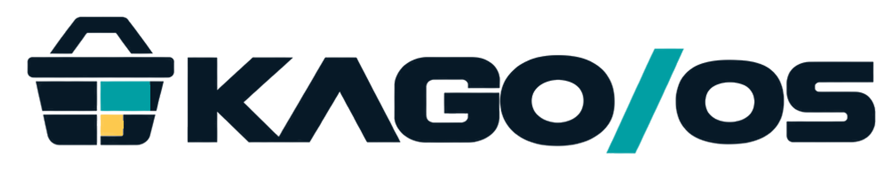

# KAGO/OS

買い物中の提案と、その後の行動・購入をつなぎ、店舗単位で販促を改善することを目指すプラットフォームです。

## 製品概要

### 背景(製品開発のきっかけ、課題等）

購入結果だけでは、どの提案に接して商品を選んだかを追いにくく、販促の改善に使える情報が限られます。KAGO/OSでは、App上の提案表示・クリック・かご操作と購買を関連付け、店舗が施策を見直せる仕組みを目指します。

### 製品説明（具体的な製品の説明）

消費者向けのKAGO/App、店舗向けのKAGO/Insight、メーカー向けのKAGO/Ads、店頭表示のKAGO/Signageを、共通DBのKAGO/Coreでつなぐ構想です。推薦の選定はAppが担当します。

現在の事前実装は、紹介LP、商品スキャン、ブラウザ内のかご・商品管理、架空の購買履歴を使うおすすめ、PWAです。共通DB・広告運用・分析・実決済は実装済みではありません。

Hack Dayでは共通認証と、Appのログイン・店舗選択・来店開始／復元の接続処理を追加しています。店舗・来店・かごのテーブル定義、来店開始関数、DB-06の権限設定は追加済みで、正式な権限でのローカル統合検証も行っています。共有Supabaseへの適用と接続設定は未確認で、未準備の場合はその旨を表示します。商品追加・履歴は後続Issueで接続します。詳細は[APP-01の接続契約と検証範囲](docs/specs/app-session-contract.md)を参照してください。

### 特長

#### 1. かごと購入履歴に応じた買い物支援

商品スキャンと関連商品のおすすめを用意しています。現時点では架空データとルールによる事前実装です。

#### 2. 通常推薦・店舗販促・メーカー広告を分ける

利用者向けの通常推薦、店舗のおすすめ、スポンサー広告を区別し、理由や広告主を示す方針です。広告の募集はAds、承認はInsightで行います。広告運用部分は今後の実装です。

#### 3. 店舗単位で結果を確認し、次の施策へ反映する

表示・反応・購入の記録を施策に結び付け、結果確認から設定更新へ進める改善ループを目指します。記録基盤と分析画面は今後の実装です。

### 解決出来ること

買い物客への関連商品・買い忘れの提案と、店舗・メーカーの販促改善を目指します。Appの操作記録と、店頭で実際に商品を手に取った行動は区別して扱います。

### 今後の展望

共通DB接続、広告募集・申請・承認、表示・操作・購買の記録、店舗向けの結果確認を実装します。購入操作は疑似購入を優先し、必要に応じて整合した架空注文データで検証します。Signageのカメラ計測は実機確認後に採否を決めます。

### 注力したこと（こだわり等）

- 通常推薦と広告を区別し、店舗が承認した広告を扱う役割分担。
- 1回の買い物の行動と、同じ利用者の継続的な購買を結ぶデータ設計。詳細は[全体Issue案](docs/issues/issues.md)で管理します。

## 開発技術

### 活用した技術

#### API・データ

- 動作確認用の架空の商品・顧客・購買履歴データ。
- 商品登録用CSVと、バーコード読み取り用の商品コード。

#### フレームワーク・ライブラリ・モジュール

- Next.js、React、TypeScript、Tailwind CSS。
- `@zxing/browser`：バーコード読み取り。
- `bwip-js`・`sharp`：バーコード・アイコン生成。

#### デバイス

- カメラ付きスマートフォン。
- 店頭表示用ディスプレイ・カメラは今後の検証対象。

### 独自技術

#### ハッカソンで開発した独自機能・技術

Hack Dayの成果は実装後に記載します。現在のコードに含まれる事前実装は[事前実装の記録](docs/development.md#prehack)で区別しています。

## 開発資料

- [共通仕様書：役割・ID・イベント・購入経路・担当確認](docs/specs/common-spec.md)
- [起動・検証手順](docs/development.md)
- [Supabaseの認証・DB接続と役割の設定](docs/development/backend.md)
- [Issue案・作業範囲・完成条件](docs/issues/issues.md)
- [GitHub運用ルール](CONTRIBUTING.md)

### SIG-06：店内傾向による選定の先行確認

Adsを起動し、`/signage/selection-demo` を開くと、架空の「パスタ多め」「パン多め」と、少人数・集計なし・期限切れ・停止を切り替えて、選定理由・重み・ポリシー版を確認できます。ログは画面内の直近20件とダウンロードJSONに保持します。個人のかごや履歴、共有DBへの通信は使いません。

`kago-os/kago-ads` で `pnpm test:signage:crowd:e2e` を実行すると、本番ビルドと実ブラウザで検証します。Chromeの場所は `CHROME_PATH` で指定できます。ポート3206を使います。

実店内集計・選定履歴のDB保存・通常の端末再生・Insight表示への接続は未実装です。暫定条件と入出力は[Ads仕様書](docs/specs/ads-spec.md)を参照してください。
