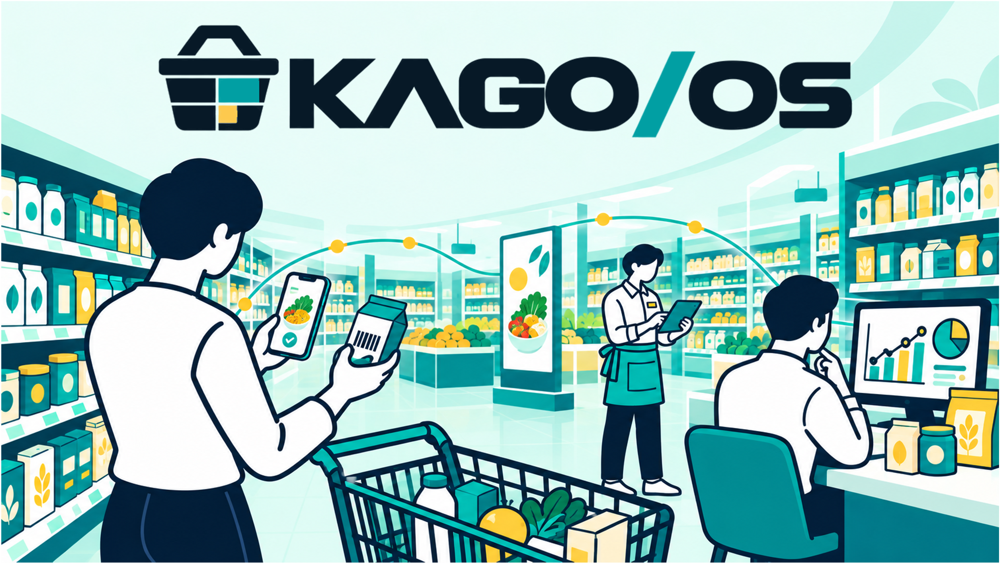

# KAGO/OS

**いつもの買い物にちょうどいい提案を**



## 製品概要

### 背景（製品開発のきっかけ、課題等）

スーパーで置き去りになっている「デジタルサイネージ」みたことありませんか？
店員にとって、チラシやデジタルサイネージで広告を出しても、「お客さんに届いたか」「商品選びにつながったか」が見えにくいことが課題です。
POSの購入結果だけでは、広告に接してから購入するまでの経緯を追いにくく、次の販促を考える材料が限られます。

一方、お客さんはチラシ広告を見なかったり、店内の広告やクーポンに気づかなかったりして、買い物に役立つ情報を見逃してしまいます。

私たちは、必要なタイミングで、おすすめやお得な情報が届く体験を目指します。

### 製品説明（具体的な製品の説明）

**KAGO/Appは、スマホで商品をスキャンしてかごに追加する買い物サービスに、関連商品やクーポンの提案を組み合わせるアプリです。** 店員はKAGO/Insightで販促を設定し、お客さんは普段の買い物の流れで商品提案に出会います。店舗側では、その後の反応や購入を振り返り、次の施策へつなげることを目指します。

```text
店員が販促を設定（Insight）
  → 買い物中に商品・クーポンを提案（App）
  → 表示・反応 → アプリのかごへ追加 → 購入
  → 結果を確認（Insight）→ 販促を見直す
```

このループを、まずはAppとInsightの小さなデモで示します。購入はアプリ内の疑似購入を対象とし、実店舗のPOS連携・実決済は今回の対象外です。「かごに入れた」はアプリ上の追加操作を指し、実物を手に取ったことを検知するものではありません。

### 特長

#### 1. スキャンする買い物の中で、商品を提案

商品スキャン・かご管理という買い物の操作に、関連商品のおすすめやクーポンを組み合わせます。広告を見るためだけの操作を増やさず、商品を選ぶタイミングで情報を届けることを狙います。今回の通知はAppを開いている間の画面内表示を対象とし、アプリを閉じていても届くプッシュ通知は対象外です。

#### 2. 店員が販促を設定し、結果を振り返る

KAGO/Insightで商品クーポンやおすすめを設定し、表示・反応・かご追加・購入などの指標を確認する流れを目指します。今回の効果グラフはサンプルデータによる説明を許容し、実際の購入結果や売上改善の実証とは区別します。

#### 3. 購入履歴を使った提案へ

同じ商品をかごに追加しても、購入履歴や利用設定に応じて提案を変えることに取り組んでいます。3人の架空利用者による比較を追加予定ですが、データの準備と、実際の配布ロジック・画面の接続確認は別の段階です。

### 解決できること・目指す価値

- **店員**：販促の設定から反応の確認までをつなぎ、施策を見直す判断材料を得る。
- **お客さん**：買い物中に関連商品やクーポンを知り、買い忘れやお得な情報の見逃しを減らす。

広告への反応と購入のつながりを可視化することを目指しており、売上向上や広告の因果効果を検証済みとするものではありません。

## 約60秒のデモ構成

以下は撮影用の構成案です。公開環境での通し確認は未完了のため、撮影時点の動作に合わせて表示・説明を確定します。

| 時間 | 映す内容 | 伝えること |
| --- | --- | --- |
| 0〜8秒 | コンセプト画像と店員・お客さんの課題 | 「広告は届いた？ お得な情報を見逃していない？」 |
| 8〜20秒 | Insightで対象商品とクーポン・値引き率を入力 | 「店員が、買い物中に届けたい販促を設定」 |
| 20〜40秒 | Appで商品をスキャンし、かごへ追加。関連商品の提案・クーポンを表示 | 「いつもの買い物の中で、商品との出会いが生まれる」 |
| 40〜53秒 | Insightの効果グラフを表示 | 「表示・反応・かご追加・購入を、次の販促の判断材料に」 |
| 53〜60秒 | 販促設定へ戻り、改善ループとサービス名を表示 | 「買い物体験と、店舗の販促改善をつなぐKAGO/App」 |

モックの入力・保存を使う場合はその画面に「デモ用・保存はモック」、効果グラフには「サンプルデータ」と表示・明記します。入力した内容がAppへ反映されたと説明するのは、DB保存からApp表示までを確認できた場合に限ります。未接続の場合は、事前設定した提案を使い「設定・配信の流れのデモ」として紹介します。

3人の比較画面を使う場合は20〜40秒の一部に組み込みます。同じきっかけ商品に対し、購入履歴ON/OFFや履歴の違いによって配布先が変わることを示す構成です。比較はクーポン選定の違いを示すもので、広告効果の比較実験ではありません。配布ロジック・比較画面の統合確認が終わるまでは、完成機能として紹介しません。

### 実装とデモの範囲（2026年10月24日時点）

| 対象 | 現在の範囲・注意点 |
| --- | --- |
| App | 商品スキャン・かご・推薦・クーポン・疑似購入に関する実装あり。撮影環境での一連の動作は別途確認が必要 |
| Insight | 販促入力・成果表示の画面あり。mainのデータ取得・保存はモック。DB接続は別PRで作業中 |
| 効果の可視化 | モックの集計表示を利用可能。今回のデモではサンプル値を使用できるが、Appでの直前の操作がリアルタイム集計されたとは説明しない |
| 3人別の提案 | 架空利用者・履歴・初期クーポンのデータを準備。履歴に応じた配布・比較の統合確認は未完了 |
| 共通DB | Supabaseの認証・DB実装あり。共有開発DBの適用・一部の本人権限での読取確認を記録済み。デモ全体の接続確認完了を意味しない |
| 今回の対象外 | 外部POS連携、実決済、バックグラウンドのプッシュ通知、サイネージの視認計測、広告による売上向上の実証 |

デモ準備と確認範囲は[60秒デモのDB準備](docs/development/demo-minimum.md)、[Appのデモ自動ログイン](docs/development/app-demo-session.md)を参照してください。公開環境での通し確認は[Issue #122](https://github.com/jphacks/hs_2604/issues/122)、READMEとデモ経路の最終照合は[Issue #123](https://github.com/jphacks/hs_2604/issues/123)で管理します。

### 今後の展望

まず販促設定からAppの提案、反応・疑似購入の記録、Insightでの結果確認までの接続を仕上げます。その後、実店舗のPOS連携やプッシュ通知などを検討します。KAGO/Ads（メーカー向け広告管理）・KAGO/Signage（店頭表示）への展開も構想していますが、今回の60秒デモはAppとInsightに絞ります。

### 注力したこと（こだわり等）

- お客さんにとって便利な買い物の流れに、商品提案を組み込むこと。
- 通常のおすすめ・店舗の販促・メーカー広告を区別し、提案の理由を伝えること。
- 店舗が販促を設定して終わらず、反応・購入を振り返る流れを設計すること。
- 実装・サンプルデータ・将来構想を分け、デモで確認できる範囲を明示すること。

## 開発技術

### 活用した技術

- Next.js、React、TypeScript、Tailwind CSS。
- Supabase：認証・共通DB（PostgreSQL）。
- `@zxing/browser`：スマートフォンのカメラによるバーコード読み取り。
- `bwip-js`・`sharp`：バーコード・アイコン生成。
- 動作確認用の架空の商品・顧客・購買履歴データ。
- デバイス：カメラ付きスマートフォン、店舗管理用PC。

### ハッカソンで開発した機能・技術

Hack Dayでは、認証・来店・かご・推薦・クーポン・疑似購入を共通DBにつなぐ実装と、店舗向け画面の開発に取り組んでいます。各機能の検証範囲は開発資料・対応PRに記録し、上記のデモ全体が完成済みとは扱いません。紹介LP・商品スキャン等の事前実装は[事前実装の記録](docs/development.md#prehack)で区別しています。

## 開発資料

- [共通仕様書：役割・ID・イベント・購入経路・担当確認](docs/specs/common-spec.md)
- [起動・検証手順](docs/development.md)
- [Supabaseの認証・DB接続と役割の設定](docs/development/backend.md)
- [Issue案・作業範囲・完成条件](docs/issues/issues.md)
- [GitHub運用ルール](CONTRIBUTING.md)

### SIG-06：店内傾向による選定の先行確認

Adsを起動し、`/signage/selection-demo` を開くと、架空の「パスタ多め」「パン多め」と、少人数・集計なし・期限切れ・停止を切り替えて、選定理由・重み・ポリシー版を確認できます。ログは画面内の直近20件とダウンロードJSONに保持します。個人のかごや履歴、共有DBへの通信は使いません。

`kago-os/kago-ads` で `pnpm test:signage:crowd:e2e` を実行すると、本番ビルドと実ブラウザで検証します。Chromeの場所は `CHROME_PATH` で指定できます。ポート3206を使います。

実店内集計・選定履歴のDB保存・通常の端末再生・Insight表示への接続は未実装です。暫定条件と入出力は[Ads仕様書](docs/specs/ads-spec.md)を参照してください。
