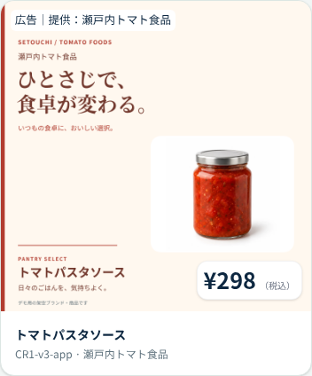
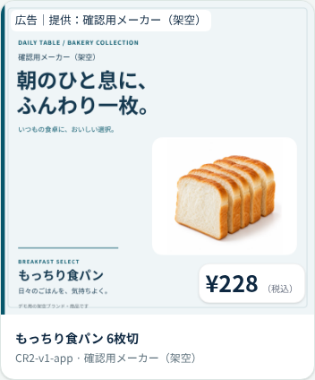

# 広告デザイン改善（ADS-05追加・#196）

## 基本方針
Appで使う白背景の商品写真と、KAGOの落ち着いた濃紺・緑・余白を参照した。広告の中心は商品写真と短いコピー。店舗販促とメーカー広告を混同しない。

| メーカー | 色 | 書体 | 共通要素 |
|---|---|---|---|
| M1 瀬戸内トマト食品 | 温かいアイボリー・トマトの赤 | 見出しは明朝体、補足はゴシック | 赤い縦線・SETOUCHIの署名・白い写真面・左下の商品名 |
| M2 確認用メーカー（架空） | 青みのある白・深い青緑 | 整ったゴシック体 | 細い外枠・DAILY TABLEの署名・白い写真面・左下の商品名 |
| 店舗販促・案内 | KAGOの濃紺・緑・白 | Appに近いゴシック | 食材かごの背景・読みやすい余白・店舗の言葉 |

DAILY TABLEは架空のメーカーのデザイン上の署名。DBのメーカー名・メーカー所属を変更するものではない。

## 素材と写真の出典
写真は docs/development/app-images-166.md に記録された、既存Appの架空デモ用生成画像を再利用。商品外観の実写や実在ブランドを示すものではない。
- tomato-sauce.webp：商品コード2900000000162
- bread.webp：商品コード2900000000056
- c-basket.webp：店舗共通の背景。顔の写るA/B素材は今回使用しない。

写真ファイルは加工・上書きせずSVGのimageとして配置し、コピー・背景・余白をコードで組み合わせてPNGへ出力する。出典パスとSHA-256はpublic/ad-assets/design-v2/sources.jsonに記録。

## 新旧の扱い
新素材は11枚：M1はCR1の第3・4版、M2はCR2のデザイン例2版、それぞれApp/Signage。店舗販促背景2枚とSignageの汎用案内1枚を含む。すべてpublic/ad-assets/design-v2/へ分け、既存の第1・2版・動画・対応表はそのまま保持する。

既存の承認済み配信や共有Storageを上書きしない。新しい広告は未申請で、登録・申請・店舗の承認を経てから配信する。M2のCR2はデザイン例で、DBへ素材・商品・メーカーを作成する処理は含めない。店舗販促・案内の新背景も比較用として用意し、現行端末の素材参照は変更しない。

広告表記・価格・店舗販促文字の共通表示部品は、白・濃紺中心に調整。商品名・理由は狭い画面で折り返し、価格と被らない寸法にした。メーカーの写真やコピーは背景側にあり、共通UIの調整でメーカーの個性を統一しない。

## 確認
/ad-designでメーカー・媒体を切り替えられる。App正方形、Signage横長、現行DB同様に正方形をSignageへ表示する場合を確認できる。

2026-10-25：新11素材の寸法・2MiB以下・元画像SHA-256、旧7素材の商品対応を確認。135テスト、lint、型検査、本番ビルド成功。実ブラウザで1280/390/320pxの新11素材と旧7素材、広告表記・価格・店舗販促文字の収まり、メーカー別フィルタ、外部通信ゼロを確認。今回の共有DBや実機カメラの操作はない。

```bash
python scripts/ad-assets/design.py
python scripts/ad-assets/check-design.py
pnpm build
node --experimental-strip-types tests/ad-design.e2e.mts
node --experimental-strip-types tests/ad-assets.e2e.mts
```



