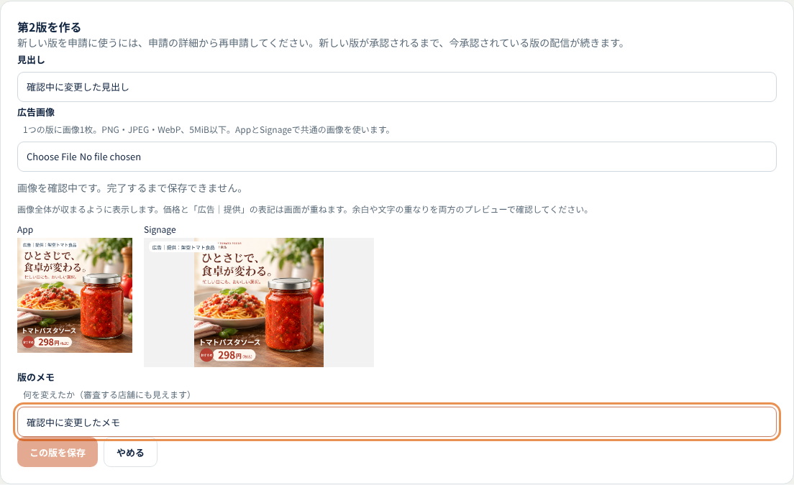

# ADS-03（#31）画像確認中の保存と入力保持

## 問題と修正

画像の検証・decodeが終わる前でも保存ボタンが有効で、版追加では変更前の画像を保存できた。非同期完了時に古いformを展開していたため、待っている間に編集した商品・見出し・メモが戻ったり、キャンセルした版追加が復活したりする可能性もあった。

- 確認中と画像エラー時は保存ボタンと保存処理を止める。確認中の説明を表示する。
- 入力更新は現在のstateへ画像だけを反映し、他の編集内容を保つ。
- キャンセル・画面移動・Source変更では古い完了結果を捨て、準備中と表示中のBlob URLを解放する。
- 不正画像の後は、別画像を選び直すか「選択前の画像を使う」を明示的に選ぶ。自動で古い画像を保存しない。
- 新規登録と版追加の両画面へ適用。認可・共有DB・素材の保存契約は変更しない。

## 確認（2026-10-26、通常保守）

- 修正前：本番ブラウザでImage.decodeを遅延させ、保存ボタンが有効のままになることを再現。
- 修正後：本番ブラウザ20項目成功。新規登録と版追加の入力保持、待機中の保存禁止、キャンセル、URL解放、画像エラー、明示的な旧画像への復帰、再選択、画面移動と戻るを確認。
- 通常183テスト、lint、本番ビルド内の型検査成功。ブラウザ試験4本は通常試験ではスキップして別途実行する。
- AuthとStorageの通信はfixture、データ読取は正式migrationのPGlite・RLS。試験中の業務データ書込は0、共有Supabase・実カメラは使用していない。
- 実共有Supabaseでの画像アップロード・保存は今回再実行していない。バックエンドの保存処理は変更していない。

再現コマンド（kago-os/kago-ads）：

```bash
KAGO_IMAGE_PREPARATION_E2E=1 pnpm test src/lib/backend/image-preparation.browser.test.ts
pnpm test
pnpm lint
```

確認画像は架空メーカー・食品画像のみ。



## 依存更新との組合せ

PR #223を一時検証ブランチへ取り込み、Next.js 16.4.3・Vitest 4.1.12でも本番ブラウザ20項目、通常183テスト、lint・型・本番ビルドを確認。現mainの16.3.8と両方で成功した。
