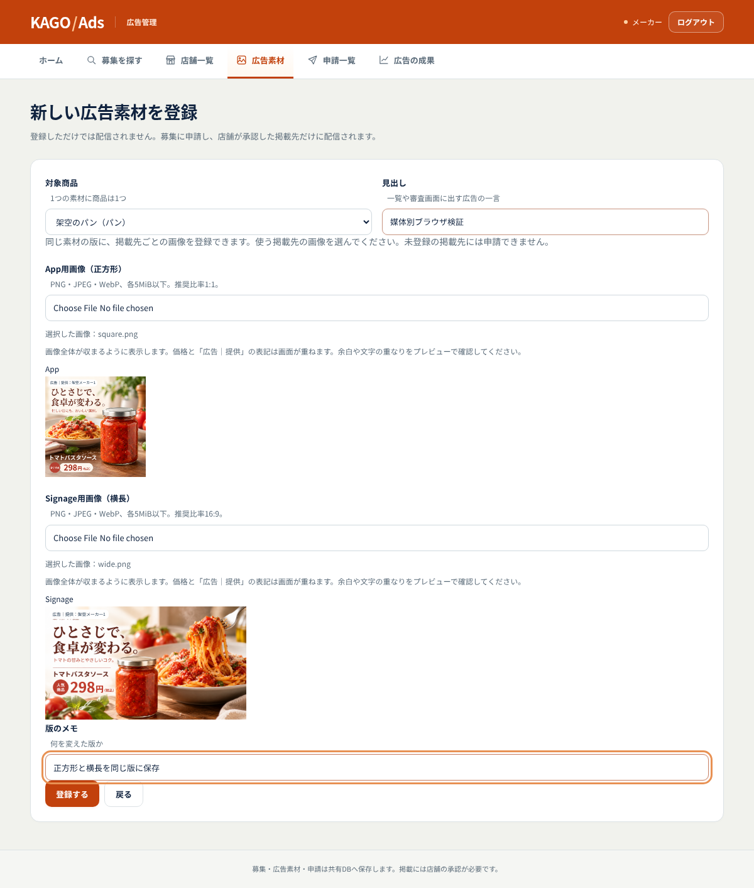
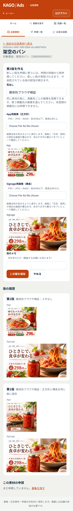
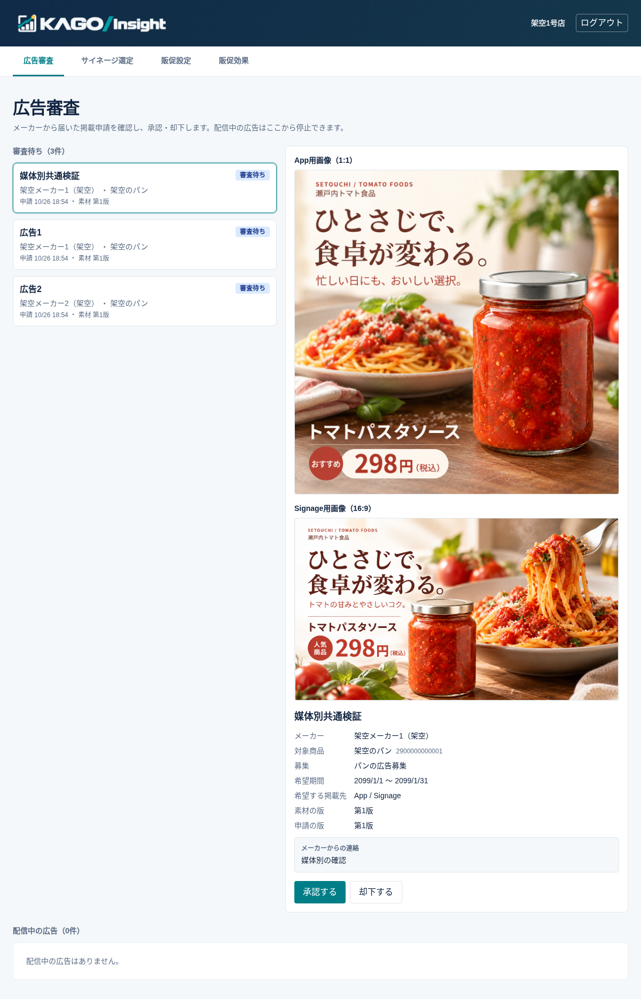
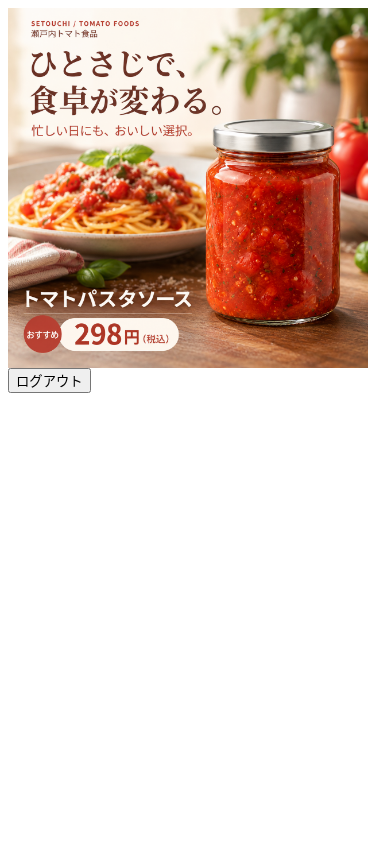

# ADS-03・ADS-05：媒体別画像（#226）

作業フェーズ：通常保守。担当：haraco1510。

## 動作と互換性

同じcreative_versionにApp（推奨1:1）・Signage（推奨16:9）を別々に登録する。各PNG/JPEG/WebPは5MiBまで。画像を切り取らず全体を表示し、動画は対象外。
片方だけでも保存できるが、未登録の媒体への申請はUIの検証とDBの両方で拒否する。登録・申請・審査は従来どおり別操作。

20261026100000_creative_media_paths.sqlはcreative_versions.image_paths（nullable jsonb）を追加する。
NULLの既存版はimage_pathを両媒体に使う。新方式はapp/signageをキー、Storage相対パスを値とし、存在するキーだけを利用する。
image_pathも残し、登録済みパスの一つを入れる（新クライアントではSignage優先）。旧版・承認済み画像の書換えや自動バックフィルはしない。
全パスはその素材とメーカーに所属する。既存の版とStorageオブジェクトは追加のみ。

kago_ad_media_paths(uuid[],text[])は既存RLSを適用し、メーカー本人・自店の審査担当・承認された媒体の利用者/端末へパスを返す。
Storageの署名発行も媒体と承認を照合する。申請に両媒体があってもAppだけを承認した場合、端末は両画像を取得できない。
利用者はApp画像、端末は自店のSignage画像のみ取得する。メーカーと審査担当は両方を確認する。

RPCが未適用なら共通画像の登録を維持する。読取側はAPIキャッシュだけが古い場合にもimage_paths列を照合し、媒体を取り違えない。
権限エラーや通信失敗は旧方式への切替理由にしない。大量の版は200件ずつ取得する。

## 画面と利用箇所

- Ads：2つのファイル選択と媒体別プレビュー。画像の検証中・失敗中は保存不可。並行した選択や見出し編集で別の入力を上書きしない。
- App：承認済み素材版のApp画像を実コンポーネントで取得。署名URLはメモリだけで保持し、有効期限前に更新する。取得失敗時は従来の商品画像を表示する。
- Signage：配信フィードがSignage画像を選ぶ。再生記録・測定・選定の版IDは従来どおり。
- Insight：申請媒体ごとの画像を1:1 / 16:9で表示し、両画像を審査する。再読込・画像失敗時の再試行を維持する。

## ローカル検証

実在のアカウント・共有DBは使用しない。全migrationを適用したPGliteのSQL/RLSと、架空のAuth・Storageを利用する。
ブラウザ試験はNext.js本番ビルドを使う。共有Supabaseでの成功を意味しない。

- pnpm test src/lib/backend/media-paths.database.test.ts：保存・再読込・再送・媒体不足・承認媒体・他社拒否・不正パス・既存版の保護・旧契約/キャッシュ互換。
- KAGO_IMAGE_PREPARATION_E2E=1 pnpm test src/lib/backend/image-preparation.browser.test.ts：準備中の保存拒否・入力保持・中止・失敗回復。
- KAGO_MEDIA_IMAGES_E2E=1 pnpm test src/lib/backend/media-paths.browser.test.ts：2枚の保存・再読込・新版で片方だけ差替え・390px幅。
- KAGO_MEDIA_CROSS_E2E=1 pnpm test src/lib/backend/media-cross.browser.test.ts：App実コンポーネント、Insight実画面、Signage実フィード。試験専用Appページは試験中だけ生成しfinallyで削除する。カメラは起動しない。
- SDKと影響する3アプリの型検査・lint・本番ビルド。

## 共有環境への反映

2026-10-26、接続情報の公開キーで空のkago_ad_media_pathsを照会し、HTTP 404 / PGRST202（API未反映）を確認した。DB適用履歴・スキーマキャッシュは管理接続がないため未確認。この作業から共有SupabaseへDDLを適用していない。

1. 適用対象プロジェクトとmigration履歴を照合する。
2. 既存migration適用済みのDBに20261026100000_creative_media_paths.sqlを適用する。
3. PostgRESTのスキーマキャッシュを再読込し、各サービスを更新する。メーカー画面も再読込する。
4. 検証用の新しい素材版で2枚を登録し、保存・再読込・審査・媒体別配信を確認する。
5. Appだけの承認、他社アカウント、無効な端末、停止後の署名再取得の拒否を確認する。既存の承認済み素材は差し替えない。

登録候補ZIPは実DBへ自動投入しない。同じデザイン版のApp/Signageの組を選べるが、CSVの架空IDやdesign_versionを実DBのUUID・版番号として使わない。

登録候補には#33で既に確認した食パン138円の販促価格の記録も引き継ぐ。参考の商品表228円は維持し、共有DBの価格は変更しない。

## 最終結果（2026-10-26）

- Ads/Signage通常試験190件、共通SDK32件、App推薦29件、登録素材のPython試験8件：成功。
- 追加ブラウザ3シナリオ（画像準備、登録/新版/再読込/390px幅、App/Insight/Signage受渡し）：成功。
- 影響する3アプリのlint・型検査・本番ビルドと、共通SDK型検査：成功。
- 通常試験のブラウザ6本は環境フラグで除外される。上記3本は別途明示的に実行した。
- mainで見つかった固定成果画面の生成物のずれは別PR #229で修正し、このブランチにも取り込んだ。オフラインの2ホスト24項目は#229側で確認した。
- 共有Supabaseでの実登録・審査・配信は未確認。API未反映と管理接続不足を上記の適用手順で解消する必要がある。

