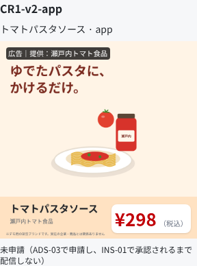
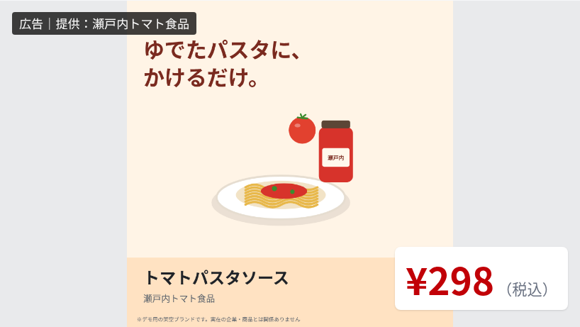

# ADS-05（#33）素材の登録準備と表示確認

素材の正本はkago-os/kago-ads/scripts/ad-assets/generate.py。ad-assets.csv・products.csvと、表示確認用ad-assets.jsonを一緒に生成する。

## 今回の確認
2026-10-25、7素材の実ファイル・商品コード・商品名・カテゴリ・寸法を照合した。PNGは実デコードと5MiB以内、MP4はH.264・yuv420p・1920×1080・10秒を確認した。

/assets-preview は共有DBやAuthへ接続せず、実際のAdMedia/PromoMedia部品で全素材を表示する。1280・390・320px幅で全素材の読み込み、文字と価格の画像内への収まり、横はみ出しなしを確認。現行DBの正方形App画像をSignageへ渡す表示もobject-containで欠けないことを確認した。動画は配信ではなくローカル素材の確認である。

## 再確認
```bash
python scripts/ad-assets/check.py
pnpm build
node --experimental-strip-types tests/ad-assets.e2e.mts
```
スクリプトはkago-os/kago-adsで実行する。check.pyにはPillowとffprobe、ブラウザ確認にはChromeが必要。CHROME_PATHで実行ファイルを指定できる。

## 登録との区別
架空ブランドで、対応表のスポンサー素材は未申請のまま。素材確認で店舗承認済みにはしない。現行DBのcreative_versionsはimage_path 1枚だけであり、App/Signage別素材と動画は登録契約が未対応。今回はDB変更・画像アップロード・承認・配信を行わない。PNGだけを既存のADS-03で扱う範囲と、将来の動画・媒体別対応を分ける。



