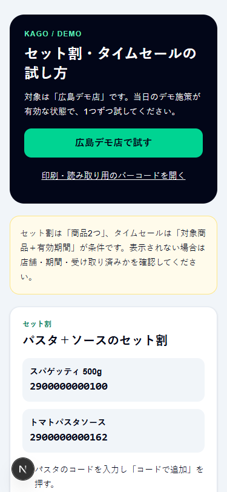
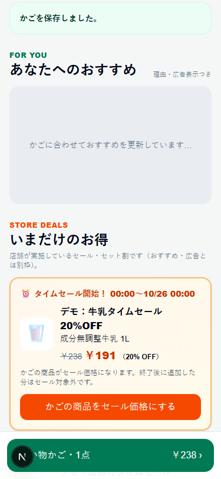
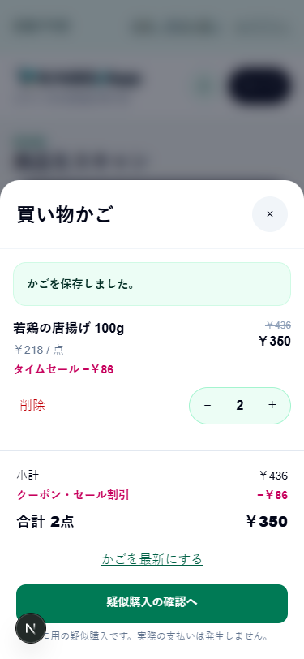

# セット割・タイムセールのデモ（#148）

対象店舗はDATA-01の「広島デモ店」（`hiroshima-demo-store` / `0da7a001-0000-4000-8000-000000000001`）。ADS01・旧KAGOストアは対象外。表示・割引・注文保存の本体は既存APP-13を使用し、通常おすすめやゲリラクーポンの選定は変更しない。

この手順で、セット割2組とタイムセール2商品を確認できる。最初にDBの準備を行い、次にAppで商品コードを入力して試す。

## 準備（DB所有者）

1. 正式migration（APP-13とクーポン入力拡張を含む）、DATA-01が適用済みか確認する。
2. デモをする日に、SQL Editorで [app_offer_demo_scenarios.sql](../../kago-os/kago-core/supabase/seed/app_offer_demo_scenarios.sql) を実行する。**共有DBへ販促を追加する操作**なので、広島デモ店がある対象プロジェクトか確認する。
3. 実行日の日本時間00:00〜翌日00:00に有効な施策を追加する。同日再実行で重複せず、当日末まで有効な同一条件の既存施策（例：パスタのセット）があれば再利用する。追加件数は0〜4件。既存施策・価格・履歴・かごは変更しない。同じIDの施策を店員が停止していても再開しない。
4. 翌日のデモでは同じSQLを再実行する。日付別の施策を作り、前日の施策を延長しない。タイムセールの終了後は新しい受け取りができず、終了前に受け取った割引は既存契約どおり購入まで有効。

SQLにはAuthパスワード・管理キーは不要。Appに管理権限を追加しない。未投入の場合、案内ページは読めるが実際のお得は出ない。今回のローカル検証は共有DBへの投入を意味しない。

## Appを開いて店舗を選ぶ

起動済みなら、そのまま [試し方の画面](http://localhost:3000/App/demo-offers) を開く。未起動の場合はリポジトリのルートから以下を実行する。

```powershell
cd kago-os/kago-app
pnpm dev
```

Supabaseの接続設定がない場合は [認証・DB接続の手順](backend.md) を先に行う。サーバー用のデモ自動ログインを使う場合は [デモセッションの設定](app-demo-session.md) を参照する。

1. 試し方の画面で「広島デモ店で試す」を押す。
2. 通常モードでは消費者アカウントでログインし、「この店舗で買い物を始める」を押す。デモ自動ログインなら自動で来店を開始・再開する。
3. 画面上部が「広島デモ店」になっていることを確認する。違う店舗なら「店舗・来店を選ぶ」から選び直す。
4. 以下のパターンを比べるときは、通常モードでは「店舗・来店を選ぶ」→広島デモ店の「空のかごで新しく来店する」→確認ダイアログで新しい来店を開始する。現在の来店を終了して空のかごにする操作。

デモ自動ログインでは店舗・来店選択のボタンを表示しない。かごから商品を削除しても、受け取った施策は同じ来店では再表示しない。再度受け取りから試したい場合は、疑似購入を完了して「次の買い物へ」で新しい来店を始めるか、デモ開始前に担当者が [デモ来店の初期化](demo-reset.md) を行う。疑似購入は実決済を行わず、接続先DBに注文を保存する。

## 試す操作

`http://localhost:3000/App/demo-offers` に商品コードと操作手順がある。ログインなしで手順を読め、「広島デモ店で試す」から店舗を選べる。開発時／デモモードは買い物画面からもリンクする。

| 種類 | 操作 | 期待結果（DATA-01の初期価格） |
| --- | --- | --- |
| パスタ＋ソース | `2900000000100`を追加 → セットでソースを追加 | 248円＋298円−24円−29円＝493円。ソース`2900000000162`を削除するとセット割が外れる |
| 牛乳＋食パン | `2900000000049`を追加 → セットで食パンを追加 | 238円＋228円−23円−22円＝421円。食パンは`2900000000056` |
| 牛乳タイムセール | 牛乳を追加 → 「かごの商品をセール価格にする」 | 1点238円−47円＝191円。対象全数量に20%OFF |
| 唐揚げタイムセール | 「セール価格でかごに追加」／`PLU-2002`を追加して適用 | 1点218円−43円＝175円、2点350円。コードは手入力可能 |

各操作は新しい来店・空のかごで比較する。単価を変更している店舗では現在価格からDBが再計算する。セットとタイムセールが同じ商品に重なると、各商品の最大割引1つだけを使用する（牛乳＋食パンのセット受け取り後に牛乳の20%OFFを適用すると397円）。

複数の有効な施策が重なると、セットは同じ商品ペアにつき割引率最大の1件、タイムセールは同じ商品につき単価の割引額最大の1件を提示する。割引を重ね掛けする表示にはしない。

### 1. パスタ＋ソースのセット割

1. 買い物画面の「商品コードを入力」に `2900000000100` を貼り付けて「コードで追加」を押す。カメラでパスタのバーコードを読んでもよい。
2. 「かごを保存しました。」が出たら、画面を下へスクロールして「いまだけのお得」を見る。
3. パスタ＋トマトパスタソースのカードで「セットでかごに追加（トマトパスタソースを追加）」を押す。ソースも先にかごへ追加している場合は「セット割を適用」になる。
4. 右上の「かご」を開く。パスタとソースにそれぞれセット割が付き、初期価格なら小計546円・割引53円・合計493円になる。
5. ソースの「削除」を押す。残ったパスタのセット割が0円になり、合計248円になる。
6. かごを閉じ、ソースのコード `2900000000162` を「コードで追加」すると、受け取り済みセットの条件が再びそろい、合計493円に戻る。

### 2. 牛乳＋食パンのセット割

1. 空のかご・新しい来店で、牛乳 `2900000000049` を「コードで追加」する。
2. 「いまだけのお得」の牛乳＋食パンカードで「セットでかごに追加（もっちり食パン 6枚切を追加）」を押す。
3. かごで、牛乳23円引き・食パン22円引き、合計421円になることを確認する。食パンを先に追加して試す場合のコードは `2900000000056`。

セット割だけを比べるときは、この段階で牛乳のタイムセールを受け取らない。

### 3. 牛乳のタイムセール

1. 空のかご・新しい来店で、牛乳 `2900000000049` を「コードで追加」する。追加直後は通常価格238円。
2. 「いまだけのお得」の牛乳タイムセールで「かごの商品をセール価格にする」を押す。
3. かごを開き、タイムセール47円引き・合計191円を確認する。
4. 牛乳の「＋」で2点にすると、割引94円・合計382円になる。

牛乳がかごにない場合はカードの「セール価格でかごに追加」でも受け取れる。セット割の確認直後に牛乳タイムセールを適用した場合は、牛乳47円引き・食パン22円引きとなり、合計397円になる。

### 4. 唐揚げのタイムセール

1. 空のかご・新しい来店で、「いまだけのお得」の唐揚げタイムセールを探す。
2. 「セール価格でかごに追加」を押す。先に商品コード `PLU-2002` で追加している場合は「かごの商品をセール価格にする」を押す。
3. かごを開き、1点43円引き・合計175円を確認する。
4. 「＋」で2点にすると、割引86円・合計350円になる。
5. 画面を再読み込みし、同じ数量・割引が残ることを確認する。

## 表示・金額が期待どおりにならない場合

| 状態 | 確認すること |
| --- | --- |
| 試し方の画面は出るが、お得のカードが出ない | 管理者が接続先DBへ当日の追加SQLを適用したか。ページの表示だけではデータは投入されない |
| 「この店舗に登録されていない商品です」と出る | 上部の店舗名が広島デモ店か。コードの0の数、前後の空白、PLUのハイフンも確認する |
| 商品一覧に牛乳・パン・パスタがない | 現在の商品一覧は野菜・肉・魚を表示する。ここで使う商品は「商品コードを入力」から追加できる |
| セット割が出ない | きっかけのパスタ／牛乳を追加したか。対象のセットが期間内・有効か。すでに受け取った場合は新しい来店で試す |
| 商品を追加しただけでは割引が付かない | お得のカードの「セットでかごに追加」「セット割を適用」「かごの商品をセール価格にする」等を押して受け取る |
| タイムセールが出ない | SQLを実行した日のJST翌日00:00を過ぎていないか。翌日のデモでは管理者が同じSQLを再実行する |
| 既定より安い／割引種別が違う | 同じ商品に別のクーポン・セールを受け取っていないか。最大の割引1つだけが使われる。比較は新しい来店で行う |
| 期待金額と違う | 現在の店舗単価が初期価格と同じか、数量が1点かを確認する。値引きは1点ごとに端数切り捨てで計算される |

## ローカル検証

Appディレクトリで `pnpm test:offer-scenarios`（正式DATA-01とSQL/RLS）、`pnpm test:offer-scenarios:e2e`（正式seedとNext/API/ブラウザ）、`pnpm test:offers`、`pnpm test:offers:e2e`。共有DB・実機カメラは別途確認する。

画面記録（架空データ・375px幅）: [試し方](../images/offer-scenarios-guide-mobile.png)、[タイムセール表示](../images/offer-scenarios-offers-mobile.png)、[唐揚げの割引付きかご](../images/offer-scenarios-cart-mobile.png)。

### 試し方の画面



### タイムセールの表示



### 唐揚げ2点のかご


