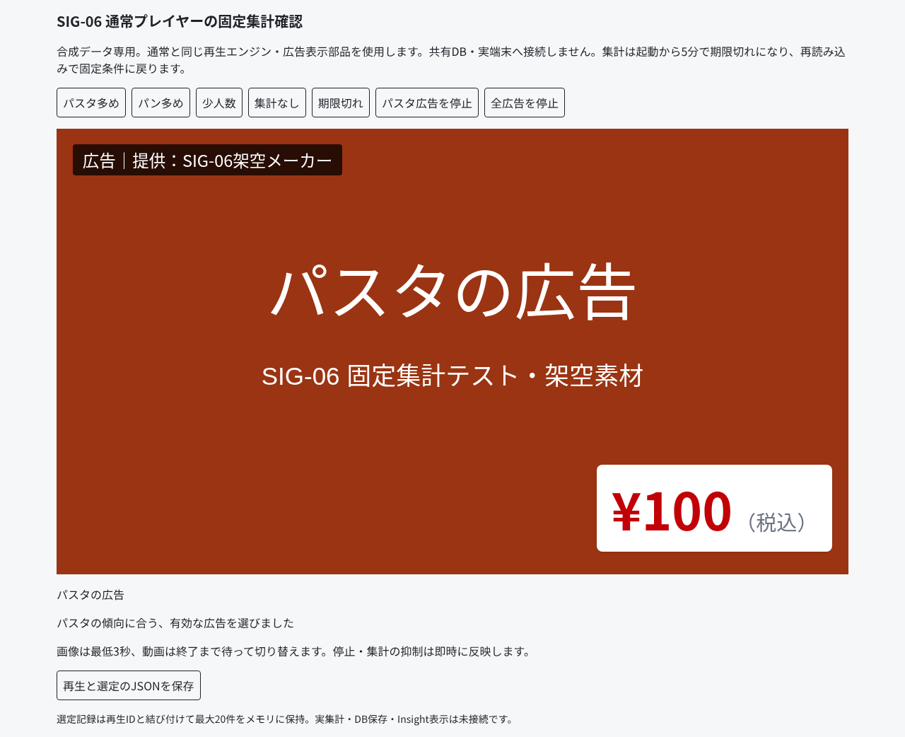

# SIG-06（#44）固定集計と通常プレイヤーの接続

/signage/selection-player は通常端末と同じSignageEngine・ScreenViewを使い、固定の合成集計からパスタ／パンの文字広告を実再生する。source・素材・集計を専用に注入し、共有DB・実端末・個人のかごや履歴には接続しない。既存の/signage/playはselect未指定であり、設定順の再生を維持する。

## 動作
- 画像は3秒の最低表示、動画は終了を守って集計変更を反映する。停止・集計の抑制は即時。
- 少人数・欠落・不正・期限切れ・一致なし・広告なしは理由付きの案内。
- 再生はadaptive／synthetic、選定理由を記録する。選定版・重み・許可された集計を再生IDで結び付け、20件までメモリに保持する。少人数の内訳は保持しない。
- JSON保存は確認画面で明示的に押した場合のみ。再生記録も確認画面のメモリ内だけで、共有DBへ送らない。

## 検証（2026-10-25）
141テスト成功（追加6件：最低表示時間、少人数、停止、欠落・期限切れ、動画の終了境界、合成再生ログ・履歴上限）。
本番ビルドのブラウザ7項目成功：実画像切替、少人数、欠落・期限切れ、停止、JSON整合性、320px、外部DB通信・画面エラーなし。

```bash
pnpm test
pnpm build
node --experimental-strip-types tests/signage-crowd-player.e2e.mts
```

## 残る接続事項
実店内集計の取得API・広告とカテゴリの正式な対応・選定履歴のDB保存・Insight表示は未実装。端末は現在、個人の来店・かご・履歴を読めない。既存権限を迂回して実集計を作らない。これらは共有DB/APIの契約を決めてから接続する。今回の合成再生でSIG-06全体が完了したとは扱わない。


