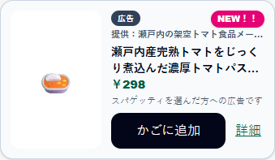
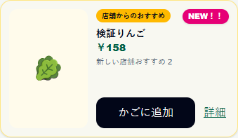
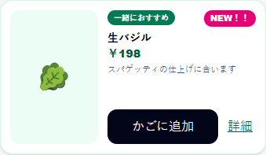

# おすすめ更新時の「NEW！！」（#156）

「あなたへのおすすめ」で、直前に正常表示できた選定に含まれなかった内容のカード右上に、ピンク色の「NEW！！」を表示する。通常おすすめ・店舗おすすめ・広告が対象。広告などの種別ラベルと提供者名は引き続き表示する。

## 表示の条件

- 商品またはカードの種別が変わった場合に表示する。同じ商品でも広告掲載・広告素材版・店舗販促版が変わった場合は新しい内容とする。
- 選定ID・枠ID・順位・数量・価格・理由文だけの変更では表示しない。
- 初回表示・ページ再読み込み・別の来店の開始は比較の基準とし、NEWを付けない。
- 同じ選定を表示している間は、自動・手動でスライドを切り替えても表示を維持する。次の選定で内容が変わらなければ消える。時間による自動消去は行わない。
- 読み込み中・通信失敗は比較元を更新しない。復旧後に最後の成功内容と比較する。同じ保存済み選定の再取得では既存のNEWを維持する。

比較状態は画面内だけで保持し、DBやイベントの契約は追加しない。選定結果の採用条件と更新の流れは[APP-08](app-recommendation-refresh.md)に従う。

## デモでの試し方

1. `/App`で、関連商品と推薦ルールが設定済みの店舗を選び、空のかごで来店を開始する。最初のおすすめにNEWが付かないことを確認する。
2. 商品コードからパスタ `2900000000100` を追加する。ソース・バジルなどが新たに推薦される設定なら、そのカード右上にNEWが付く。広告枠は有効な承認済み掲載がある場合だけ表示される。
3. おすすめの矢印を押してカードを切り替える。新しい内容のカードすべてにNEWがあり、前からある内容には付かないことを確認する。
4. かごのパスタの数量だけを増やす。推薦内容が同じなら、再選定されてもNEWは付かない。
5. ページを再読み込みする。同じおすすめが初回の基準になり、NEWが消えることを確認する。

共有DBに必要な商品・ルール・掲載がなければ、新しいカードは出ない。この変更はデータを投入しない。割引の試し方は[セット割・タイムセールのデモ](../development/offer-demo-scenarios.md)を参照する。

## ローカル検証

Appディレクトリで`pnpm test:suggestions:new`（内容比較7件）、`pnpm test:suggestions:new:e2e`（ブラウザ6シナリオ）を実行する。ブラウザ検証は正式SQL/RLSを適用した使い捨てPGlite、ローカル認証アダプター、実際のNext画面/APIを使用する。共有Supabaseへの投入や実機カメラの確認は含まない。

ブラウザでは初回、新しい通常おすすめと広告、同一内容の再選定、店舗販促版の更新、読み込み失敗からの復旧、再読み込み・来店切り替えを確認する。長い商品名・提供者名と320〜375px幅でも表示が崩れないことを確認する。

画面記録（架空データ・375px幅）:

| 広告 | 店舗おすすめ | 通常おすすめ |
| --- | --- | --- |
|  |  |  |
