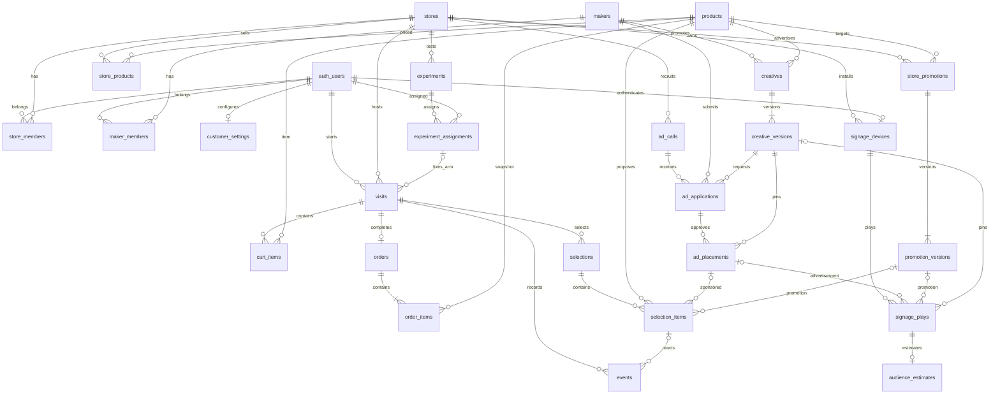

# KAGO/OS 共通DB設計

| 項目 | 内容 |
| --- | --- |
| 対象 | [DB-01 #8](https://github.com/jphacks/hs_2604/issues/8) |
| 版・日付 | v0.1・2026-10-24（hackday） |
| 担当 | dustin-ctrl |
| 状態 | 設計案・レビュー待ち。テーブル・RLS・DB関数は未実装 |
| 基準 | [共通仕様 v0.3](common-spec.md)、[認証・接続ガイド](../development/backend.md) |

CoreはSupabase PostgreSQLのテーブル・制約・RLS・DB関数・集計ビューを担当する。推薦計算・選定はAppのサーバー側、集計の表示はInsight／Adsが担当し、Coreに業務HTTP APIを追加しない。DB-01ではDDLの適用・データ投入を行わない。

## 共通の型と制約

- PKはUUID（通常DB生成、イベント・再生は送信側生成）。Auth利用者は`auth.users.id`を参照する。
- 時刻は`timestamptz`。期間は`[starts_at, ends_at)`、開始＜終了。日付指定の最終日はAsia/Tokyoの翌日0時を終了値にする。
- 金額は税込円の`integer`（0以上）、数量は`integer`（1以上）、版は`integer`（1以上）。商品コードは`text`で先頭0を保持する。
- 列挙値は本文で列挙する`text CHECK`、媒体集合は空でない`text[]`で`app`／`signage`に限定し重複を許さない。
- `data_origin`は`operated`／`seeded`／`synthetic`。実操作・事前投入・疑似値を区別する。異なる由来を成果集計で結合しない。
- 参照済みマスター・版・注文・計測記録は物理削除しない。FKは原則`ON DELETE RESTRICT`。利用停止は状態で表す。Auth退会の匿名化・保存期限は別途運用判断とし、無条件CASCADEは設定しない。
- 複数行にまたがる条件をCHECKだけで保証したことにしない。複合FK・一意制約で表現し、表現できない状態遷移・期間包含・合計は権限を絞ったDB関数／トリガーで検査する。

## 関係図

任意の広告・販促参照の排他条件は項目表と参照制約で定める。ER図だけでは排他・同店舗の保証を表現しない。

## テーブル・項目表

以下が保存列の設計案。`?`はNULL可、それ以外はNOT NULL。`id`はUUID PK、`user_id`・`approved_by`・`reviewed_by`・`auth_user_id`はUUIDでAuth参照。`*_id`は特記以外UUIDのFK。`created_at`はDB現在時刻、`updated_at`はDB側で更新するtimestamptz。本文の日時列もすべてtimestamptz。複合キーのみの表は`id`を作らない。

### 店舗・商品・利用者（DB-02）

| テーブル | 列（型・参照） | キー・条件 |
| --- | --- | --- |
| `stores` | id, slug text, name text, branch_name text?, timezone text, created_at | slug UNIQUE、timezoneは今回`Asia/Tokyo` |
| `store_members` | store_id→stores, user_id→Auth, role text, created_at | PK(store_id,user_id)、role=`staff`。募集・審査の分離は未採用、サービスごとの機能権限で制限 |
| `products` | id, code text, name text, category text, created_at | code UNIQUE・空文字不可。PLU／JANを数値変換しない |
| `store_products` | store_id→stores, product_id→products, price integer, is_active boolean, updated_at | PK(store_id,product_id)、price≧0 |
| `customer_settings` | user_id→Auth, slug text?, use_purchase_history boolean, use_current_cart boolean, updated_at | PK(user_id)、slugは非NULLならUNIQUE。同意の初期値はfalse |

### 来店・かご・注文（DB-03・DB-07）

| テーブル | 列（型・参照） | キー・条件 |
| --- | --- | --- |
| `visits` | id, user_id→Auth, store_id→stores, status text, started_at, ended_at?, last_activity_at, cart_version integer, assignment_id?→experiment_assignments, experiment_arm text? | status=`active/completed/abandoned`。cart_version≧0。終了状態のみended_at必須、ended_at≧started_at。UNIQUE(id,user_id,store_id) |
| `cart_items` | visit_id→visits, product_id→products, quantity integer, updated_at | PK(visit_id,product_id)、quantity≧1。店舗の取扱商品かつ来店activeのみ更新。削除は行削除＋イベント保存 |
| `orders` | id, visit_id→visits, user_id→Auth, store_id→stores, ordered_at, total integer, idempotency_key uuid, cart_version integer, data_origin text, created_at | UNIQUE(visit_id)、UNIQUE(idempotency_key)、total≧0。複合FK(visit_id,user_id,store_id)→visits。同一要求で内容が変われば拒否 |
| `order_items` | order_id→orders, product_id→products, product_name text, unit_price integer, quantity integer | PK(order_id,product_id)、unit_price≧0、quantity≧1。購入時の名前・単価の不変スナップショット |

DB-07は来店行をロックし、本人・active・期待cart_version・非空かご・取扱状態・現価格を確認して、注文・明細・来店終了を1トランザクションで保存する。totalは明細のunit_price×quantityの合計（integer上限超過は拒否）。再送時は既存注文を返す前に本人・来店・確定時cart_versionの一致を確認する。終了後の再送を新規注文にしない。かご更新も来店行をロックし、更新・cart_version加算・イベントを原子的に保存する。同じevent_idの再送では更新しない。3時間放棄は共通仕様Q-07の案であり閾値の担当確認待ち。

購入確定は`kago_checkout`としてDB-07で実装した。DB-03〜DB-08の実装・適用手順は[共通DBガイド](../development/database.md)を参照。実験のassignment_id／experiment_armはDB-05で追加した。かごと明細の同店舗商品検査はvisit／orderの店舗を使うトリガー、注文の利用者・店舗一致は複合FKで保証する。購入確定時の合計・版・時刻検証と原子的保存はDB-07で実装する。

### 広告・申請・販促（DB-04・DB-08）

| テーブル | 列（型・参照） | キー・条件 |
| --- | --- | --- |
| `makers` | id, slug text, display_name text, is_fictional boolean, created_at | slug UNIQUE |
| `maker_members` | maker_id→makers, user_id→Auth, created_at | PK(maker_id,user_id) |
| `ad_calls` | id, store_id→stores, title text, description text?, categories text[], channels text[], starts_at, ends_at, status text, disclosure_scope text[], created_at, updated_at | status=`draft/open/closed`（後戻り不可）。categories空不可。disclosure_scopeは`impressions/clicks/cart_adds/purchases/signage_views`の部分集合（空可）。公開後は店舗・媒体・期間を固定、closedは変更不可 |
| `creatives` | id, maker_id→makers, product_id→products, created_at | 1素材1商品。参照後のメーカー・商品の変更禁止 |
| `creative_versions` | id, creative_id→creatives, version integer, image_path text, image_paths jsonb?, headline text, note text?, created_at | UNIQUE(creative_id,version)、versionは素材ごとに1からの連番。image_pathは旧方式の保存先キー。image_pathsはapp/signage別の保存先キー（NULLなら旧方式、未登録媒体は申請不可）。URL・署名付きURLを保存しない。追加のみ |
| `ad_applications` | id, ad_call_id, store_id, maker_id, creative_id, creative_version_id, channels text[], requested_period tstzrange, message text?, revision integer, status text, review_comment text?, reviewed_by?→Auth, reviewed_at?, created_at, updated_at | status=`submitted/approved/rejected`。複合FK(ad_call_id,store_id)→募集、(creative_id,maker_id)→素材、(creative_version_id,creative_id)→版。UNIQUE(ad_call_id,creative_id)。期間は有限非空の`[)`、募集内。channelsは募集の部分集合。提出はopenかつ募集終了前のみ。却下理由は必須・200字以内 |
| `application_revisions` | application_id→ad_applications, revision integer, creative_version_id, channels, requested_period, message?, submitted_at, status, review_comment?, reviewed_by?, reviewed_at? | PK(application_id,revision)。申請の各回をad_applicationsのトリガーだけが記録。直接の変更・削除不可 |
| `ad_placements` | id, application_id, revision, store_id, creative_version_id→creative_versions, channels text[], starts_at, ends_at, status text, approved_by→Auth, approved_at, suspend_reason?, suspended_by?→Auth, suspended_at? | status=`active/suspended/expired/superseded`。複合FK(application_id,store_id)→申請、(application_id,revision)→承認した回。UNIQUE(application_id,revision)、UNIQUE(application_id) WHERE status=`active`。承認版・媒体・期間・承認者・承認時刻を固定。停止は理由・停止者必須 |
| `store_promotions` | id, store_id, product_id, created_at | 販促の同一性。複合FK(store_id,product_id)→store_products。店舗・商品の変更禁止 |
| `promotion_versions` | id, promotion_id→store_promotions, version integer, channels text[], time_windows jsonb, priority integer, reason_text text, starts_at, ends_at, status text, created_at | UNIQUE(promotion_id,version)、versionは連番、priority≧0、status=`active/inactive`。販促ごとにactiveは1版まで。内容は追加のみ、状態はactive→inactiveのみ |

`time_windows`は`[{"weekdays":[1,2,3,4,5,6,7],"start":"16:00","end":"19:00"}]`（ISO曜日、店舗時間帯）。空配列は終日。時刻はHH:mm（endのみ24:00可）、start＜end、日跨ぎは2窓に分割し、窓内の重複曜日と同じ曜日で重なる窓を拒否する。DB-04でJSON構造を検査する。販促の版と行IDを分け、参照列は常に`promotion_version_id`とする。

`requested_period`は共通仕様の単一範囲列を採用する設計案。Adsの画面入力`requested_start/requested_end`は境界でこの範囲に変換する。`expired`は共通仕様どおり保持するが、失効状態の更新が遅れても期間条件で配信から除外する。再申請で申請の状態を戻しても、旧配信対象に保存した承認版を変更しない。承認切替はDB-08で同じ申請をロックし旧activeをsupersededにして新activeを作る。停止・再審査では承認者の自店所属を再検証する。DB-08で`kago_approve_application`・`kago_reject_application`・`kago_suspend_placement`と操作履歴`ad_operation_logs`として実装した。

### 選定・行動・実験・端末（DB-05）

| テーブル | 列（型・参照） | キー・条件 |
| --- | --- | --- |
| `selections` | id, visit_id→visits, cart_version integer, rule_version integer, created_at | cart_version≧0、ルール版は1以上の整数。Appのルール成果物と版を対応させ不変に保つ。同じかごで複数選定を許す。保存時にactive来店の現在の版と一致。created_atの既定値はclock_timestamp()。同じIDの同内容再投入は無操作 |
| `selection_items` | id, selection_id→selections, slot integer, placement_type text, product_id→products, ad_placement_id?→ad_placements, promotion_version_id?→promotion_versions, rank integer, reason_code text, reason_text text | UNIQUE(selection_id,slot)、UNIQUE(selection_id,product_id)。slot=1〜3、rank≧1。広告・販促は各1枠まで。reason_codeは`sponsored_*`＝広告、`store_*`＝販促、それ以外＝通常推薦。`replenishment`は履歴利用ON時のみ。種別条件は次節 |
| `events` | event_id uuid PK, event_type text, schema_version integer, occurred_at, received_at, store_id→stores, channel text, user_id→Auth, visit_id→visits, selection_item_id?→selection_items, product_id?→products, payload jsonb, data_origin text | schema_version=1、channel=`app`。received_atはDBのみ付与。複合FK(visit_id,user_id,store_id)→visits、(store_id,product_id)→store_products。種類別payloadをCHECKで検査。同ID同内容は無操作、異内容は拒否。枠ごとの2件目以降の実表示は無操作。追記のみ |
| `experiments` | id, store_id→stores, slug text, channel text, unit text, arms text[], starts_at, ends_at, version integer, created_at | UNIQUE(store_id,slug,version)、2群以上・重複なし。appのunit=`user`、signageのunit=`device_time_window` |
| `experiment_assignments` | id, experiment_id→experiments, user_id→Auth, arm text, assigned_at | UNIQUE(experiment_id,user_id)。App実験のみ。armは参照実験のarms内。Appサーバーのみ作成 |
| `signage_devices` | id, store_id→stores, auth_user_id→Auth, slug text, location text, is_active boolean, created_at | UNIQUE(auth_user_id)、UNIQUE(store_id,slug)。認証metadataのdevice_id/store_idとDB行を照合 |
| `signage_plays` | id, device_id→signage_devices, ad_placement_id?→ad_placements, promotion_version_id?→promotion_versions, creative_version_id?→creative_versions, mode text, reason_code text, started_at, ended_at, received_at, data_origin text, media_kind text?, end_reason text? | mode=`schedule/adaptive/fallback`、ended_at≧started_at（終了後に送信、未終了は保存しない）。広告・販促は排他、fallback案内のみ両方NULL。広告では承認素材版必須、同店舗・signage媒体・期間内。media_kind=`image/video`、end_reason=`completed/updated/suspended/expired/media_error/closed`（#39の提案） |
| `audience_estimates` | play_id→signage_plays, method_version text, measurement_status text, estimated_viewers integer?, estimated_view_seconds numeric?, data_origin text, received_at | PK(play_id)、status=`measured/not_measured/error`。measured時のみ人数・秒数必須かつ≧0、それ以外は両方NULL |

実験は余力拡張（APP-10／INS-04）。visits.assignment_idとexperiment_armは両方NULLか両方非NULL。割当先の利用者・店舗と来店を一致させ、参照後の群を変更しない。Signageの時間窓割当は個人用experiment_assignmentsへ入れず、実装時に端末・時間窓をキーとする別表をDB-05で追加する。この版ではSignageのA/B比較実装を約束しない。

## 参照と状態を守る制約

| 対象 | DB側で保証する内容 | 実装先 |
| --- | --- | --- |
| 同店舗の商品 | かご・注文・選定の来店店舗、広告募集の店舗、販促店舗、端末店舗でstore_productsの組が存在する。新規追加・選定・配信時はis_activeも検査 | DB-02〜05、DB-07・08 |
| 提案の種別 | organicは広告／販促参照ともNULL。sponsoredは広告だけ必須。store_promoは販促版だけ必須。商品は参照素材／販促の商品と一致 | DB-05 |
| 提案操作 | selection_item→selection→visitをたどり認証本人・来店・店舗・商品が一致。提案種別・広告主・版は参照から取得 | DB-05・06 |
| イベント種別 | 共通仕様8.2の10種類に限定。recommendation_*は枠必須。scan_failed以外の商品操作はproduct必須、比較はpayload.product_idsに2商品以上、削除理由は対象削除イベントを本人の来店内で参照 | DB-05 |
| かご操作 | source=`scan/manual/recommendation`、後者は枠必須。quantity≧0、quantity_deltaは整数、cart_version≧1。追加・数量変更・削除のpayloadと実際の変更を同一処理で照合 | DB-03・05、APP-02 |
| 重複・改ざん | event_id・再生idはPK。同ID同内容の再送は無操作、異なる内容での再送は拒否。実表示は枠ごとに1件（部分UNIQUE(selection_item_id) WHERE event_type=`recommendation_impression`） | DB-05・06 |
| 広告承認 | 配信店舗＝募集店舗、素材のメーカー＝申請者、素材版・期間・媒体は審査した内容に一致。承認時に参照内容を固定 | DB-04・08 |
| Signage | 端末の店舗と配信対象／販促店舗が一致。広告のcreative_version_idは配信対象と一致。user_id／visit_id列を持たない | DB-05・06 |

イベントpayloadの種類別必須項目は[共通仕様8章](common-spec.md#events)を正本とする。比較・削除理由の余力拡張は有効化するまで受付しない。一般利用者はかご更新イベント・注文・割当・選定を直接INSERTできない。Appサーバーで計算しても、本人JWTを使うだけではブラウザと区別できないため、特権書込はDB-06で一般ロールから実行権を剥奪した専用処理に限定する。サーバーは検証済み本人IDを使い、入力user_idを信用しない。秘密キーはサーバー側だけに置く。注文・承認関数は呼出し元の所属・本人を再検証する。

## 読み書き範囲と認可（DB-06への契約）

RLSを全業務表で有効にし、未認証と所属なしは拒否する。app_metadataのroleだけで店舗・メーカー所属を認可せず、store_members／maker_membersを参照する。所属表・端末対応の変更は管理者の投入処理のみ。複数所属は所属ごとに許可する。

| データ | App消費者 | Ads店舗 | Adsメーカー | Insight店舗 | Signage端末 |
| --- | --- | --- | --- | --- | --- |
| 店舗・商品・店舗別価格・メーカー公開名 | 配信に必要な公開項目R | 自店R | 公開項目R | 自店R | 自店配信に必要な項目R |
| 所属・設定 | 自分の設定CRU | 自分の所属R | 自分の所属R | 自分の所属R | 自端末対応R |
| 来店・かご | 本人CRU、終了後更新不可 | 不可 | 不可 | 集計のみ | 不可 |
| 注文・明細 | 本人R、作成はDB-07のみ | 不可 | 許可された自社広告の集計のみ | 自店集計のみ | 不可 |
| 募集 | 不可 | 自店CRU | openの公開項目R | 自店R | 不可 |
| 素材・版 | 承認済み配信分R | 自店申請分R | 自社CR、編集は新しい版 | 自店申請分R | 自店承認済み配信分R |
| 申請・審査結果 | 不可 | 自店宛R | 自社CR、再申請処理のみU | 自店R、審査処理のみU | 不可 |
| 配信対象 | 自店の有効分R | 自店状態R | 自社申請状態R | 自店R、DB-08のみCU | 自店の有効分R |
| 販促・版 | 自店の有効分R | 不可 | 不可 | 自店CR、停止処理U | 自店の有効分R |
| 選定・枠 | 本人R、作成はAppサーバーのみ | 不可 | 不可 | 自店の必要範囲R（個人IDを返さない） | 不可 |
| イベント | 本人の許可種別C（かご操作は専用処理）、本人R | 不可 | 許可された自社広告の集計のみ | 自店集計のみ | 不可 |
| 実験・割当 | 条件R・自分の割当R、割当CはAppサーバー | 不可 | 不可 | 自店条件CR、変更は新しい実験版 | 自店条件R、個人割当不可 |
| 再生・推定 | 不可 | 不可 | 許可された自社広告の集計のみ | 自店R | 自端末C・R |

DB-06で上表を実装した（[共通DBガイド](../development/database.md)のDB-06節）。表との差：メーカーは`closed`の募集も一覧できる（ADS-01の終了分表示）、消費者は全店舗の`active`配信対象・販促版を読める、配信対象・審査履歴の`approved_by`／`reviewed_by`（店舗担当のAuth UUID）は読める範囲の利用者に見える。承認・配信対象の作成と停止はDB-08、来店・かご・注文・実験割当の書込みは所有者権限の関数に限定する。

集計ビュー／DB関数も呼出し元の自店・自社を検査する。メーカーへvisit_id・user_id・注文行・生イベント・他社広告・通常推薦・店舗販促を返さない。disclosure_scopeで許可された指標だけを返し、非公開と0を区別する。サーバーの特権クライアントで無条件に全行を返さない。匿名公開は別途必要性を確認するまで許可しない。

## 由来・代替購入・カメラと集計

- DATA-03はorders／order_itemsへ通常と同じ制約で投入し、対応visitsをcompletedにする。表示→反応→購入の一式はseededで統一する。履歴のみの過去注文は提案成果と結ばない。投入の再実行は固定UUID・idempotency_keyで件数を増やさない。
- 注文が購入の正本。購入イベントを増やして代用しない。operatedもデモ担当者の疑似購入であり、実決済を意味しない。
- カメラ未採用・失敗はnot_measured／errorとNULL、実測0人はmeasuredと0。疑似計測はsyntheticで分離。映像・顔ID・個人追跡子を保存しない。
- 再生は開始時刻のAsia/Tokyoの1時間枠へ帰属、終了を含まない。3秒未満は保存するが集計対象外（共通仕様の採用案）。推定人数を再生間で足してユニーク人数と説明しない。
- 実表示の生記録と集計の重複排除を分離。集計キーは(visit_id,product_id,placement_type)、最初の実表示の版へ帰属する。異なる枠の再表示をDBで捨てない。
- AppとSignageを結合して個人の視聴→購入を作らない。Signageは同店舗・時間帯の販売の参考値のみ。集計の詳細は[共通仕様9章](common-spec.md#metrics)。

## 2店舗・2利用者・1メーカーの机上確認

以下は仕様から導いた期待結果で、SQL・RLSの実行結果ではない。S1・U1・U2・M1は共通仕様11章の略号を使用し、S2＝架空の広島第2店、D2＝S2端末、T1／T2＝各店舗担当、W1＝M1担当を追加する。U1はS1にV1、U2はS2にV2を持つ。両店で同じ商品P-SAUCEを販売する。M1は両店の募集C1／C2へA1／A2を申請し、配信PL1／PL2を得る。

| ケース | 保存先・期待結果 | 検証担当 |
| --- | --- | --- |
| U1がS1でP-PASTAとP-SAUCEを疑似購入 | V1→O1、明細2件、248＋298＝546円。U1のみ注文行R、T1は集計のみ | DB-03・07、TEST-01 |
| U2がS2でP-PASTAのみ購入 | V2→O2、248円。全体794円、S1は546円、S2は248円 | DB-03・09 |
| U2がV1またはO1を要求 | 拒否、かご・注文とも変更なし | DB-06 |
| V2からPL1の枠を保存、D2がPL1を再生 | 同じメーカー・商品でも他店舗参照のため拒否 | DB-05・06 |
| T1がC2／A2を編集・承認 | 自店所属がないため拒否。T2もC1／A1は同様 | DB-04・06・08 |
| W1が承認状態を直接変更 | 拒否。自社申請・版は読めても承認権限なし | DB-06・08 |
| W1がPL1／PL2の成果を確認 | 各募集の公開範囲内のみ。S1が購入を非公開ならS1購入は非公開、S2の設定を流用しない | DB-09、ADS-04 |
| D1／D2が注文・個人履歴を要求 | 拒否。自端末の再生・推定以外を書けない | DB-06 |
| O1の同じ要求を再送、別来店で要求キーを再使用 | 同内容はO1を返す、別来店は拒否。注文合計794円を保持 | DB-07 |
| 素材の第3版を作成 | PL1／PL2と過去枠・再生は承認した第2版を保持 | DB-04・08 |
| カメラ失敗後に0人の実測を記録 | 前者NULL、後者0、未計測を0人の実績として集計しない | DB-05、SIG-05 |
| DATA-03で同例を事前投入 | operatedとは別の固定ID一式でseededを保存、由来別の794円として表示 | DATA-03、DB-09 |

受入時はDB-06で各アカウントから直接要求を送り、許可／拒否の両方を実証する。DB-01の文書検査をRLSの実証と扱わない。

## 実装への引継ぎとレビュー事項

| Issue | この設計から実装する範囲 |
| --- | --- |
| DB-02 #9 | 店舗・所属・商品・価格・設定 |
| DB-03 #10 | 来店・かご・注文・明細 |
| DB-04 #11 | メーカー・募集・素材版・申請・配信対象・販促版 |
| DB-05 #12 | 選定・イベント・実験・端末・再生・推定 |
| DB-06 #13 | RLS・特権処理への実行権・役割別拒否の検証 |
| DB-07 #14／DB-08 #15／DB-09 #16 | 注文の原子性・承認切替・由来別集計 |

[Ads設計PR #54](https://github.com/jphacks/hs_2604/pull/54)は未マージの提案として確認した。以下を本PRのレビューで調整し、採用する変更は共通仕様を先に更新する。

| 論点 | この設計の扱い・確認先 |
| --- | --- |
| 日付の終了境界 | 共通仕様の[開始,終了)を維持。最終日翌日0時に変換（Ads担当確認待ち） |
| requested_start/end | DBはrequested_period。画面との変換で対応（Ads担当確認待ち） |
| description・note・message・suspend_reason | DB-04でNULL可の列として採用。媒体別画像は#226の追加migrationでimage_pathsに保存。動画は対象外 |
| application_revisions | DB-04で採用（2026-10-24、担当判断）。共通仕様5章への反映はCOM-01担当へ依頼 |
| 媒体別assets・動画・description | 媒体別画像は#226で合意したimage_paths（app/signageの相対パス）を採用。NULLの旧版はimage_path共通画像。動画は未採用 |
| 承認時の媒体絞込み・承認済みからの再申請 | 共通仕様の状態遷移から拡張が必要。DB-08・Insight・Adsで合意後に反映 |
| 店舗担当者の役割 | 現接続基盤のstore_staff＋自店所属。募集／審査の細分化はDB-06で判断 |

人間の担当確認・承認は未確認。DB-01は設計レビュー後に確定し、下流の実装結果はそれぞれのIssueで記録する。

## DB-09の集計契約

[集計ビュー・期間指定関数の利用手順](../development/database.md#db09)に、初回表示への帰属・由来の分離・Signageの時間枠・メーカーへの公開指標を定義する。内部の帰属ビューは一般ロールに公開せず、公開ビューは個人IDを含まない集計だけを返す。由来が未保存の選定枠数はunclassifiedで取得し、実操作へ推測分類しない。

## SIG-06：店内集計と選定履歴（#44）

追加migration：20261026010000_signage_crowd_decisions.sql。集計RPCは端末本人の自店だけを対象に、直近15分の活動利用者とカテゴリを5人以上で返す。個人ID・明細は返さない。signage_decisionsはplay_id（再生への外部キー・主キー）、device_id、store_id、selected_at、decision（選定版・理由・重み・保護済み集計）、recorded_atを保持する。端末は専用RPCで自分の再生にだけ履歴を追加し、自店スタッフだけが読む。更新・削除は一般利用者に許可しない。詳細・適用状況・再送の制約は[実装と検証](../development/signage-live-crowd.md)を参照。
