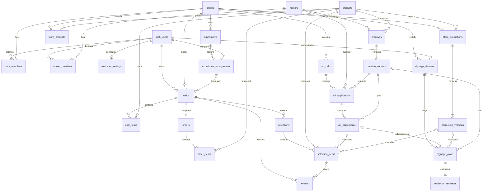

# KAGO/OS 共通DB設計

| 項目 | 内容 |
| --- | --- |
| 対象 | [DB-01 #8](https://github.com/jphacks/hs_2604/issues/8) |
| 版・日付 | v0.1・2026-10-24（hackday） |
| 担当 | dustin-ctrl |
| 状態 | 設計案・レビュー待ち。テーブル・RLS・DB関数は未実装 |
| 基準 | [共通仕様 v0.3](common-spec.md)、[認証・接続ガイド](../development/backend.md) |

CoreはSupabase PostgreSQLのテーブル・制約・RLS・DB関数・集計ビューを担当する。推薦計算・選定はAppのサーバー側、集計の表示はInsight／Adsが担当し、Coreに業務HTTP APIを追加しない。DB-01ではDDLの適用・データ投入を行わない。

## 共通の型と制約

- PKはUUID（通常DB生成、イベント・再生は送信側生成）。Auth利用者は`auth.users.id`を参照する。
- 時刻は`timestamptz`。期間は`[starts_at, ends_at)`、開始＜終了。日付指定の最終日はAsia/Tokyoの翌日0時を終了値にする。
- 金額は税込円の`integer`（0以上）、数量は`integer`（1以上）、版は`integer`（1以上）。商品コードは`text`で先頭0を保持する。
- 列挙値は本文で列挙する`text CHECK`、媒体集合は空でない`text[]`で`app`／`signage`に限定し重複を許さない。
- `data_origin`は`operated`／`seeded`／`synthetic`。実操作・事前投入・疑似値を区別する。異なる由来を成果集計で結合しない。
- 参照済みマスター・版・注文・計測記録は物理削除しない。FKは原則`ON DELETE RESTRICT`。利用停止は状態で表す。Auth退会の匿名化・保存期限は別途運用判断とし、無条件CASCADEは設定しない。
- 複数行にまたがる条件をCHECKだけで保証したことにしない。複合FK・一意制約で表現し、表現できない状態遷移・期間包含・合計は権限を絞ったDB関数／トリガーで検査する。

## 関係図

任意の広告・販促参照の排他条件は項目表と参照制約で定める。ER図だけでは排他・同店舗の保証を表現しない。
