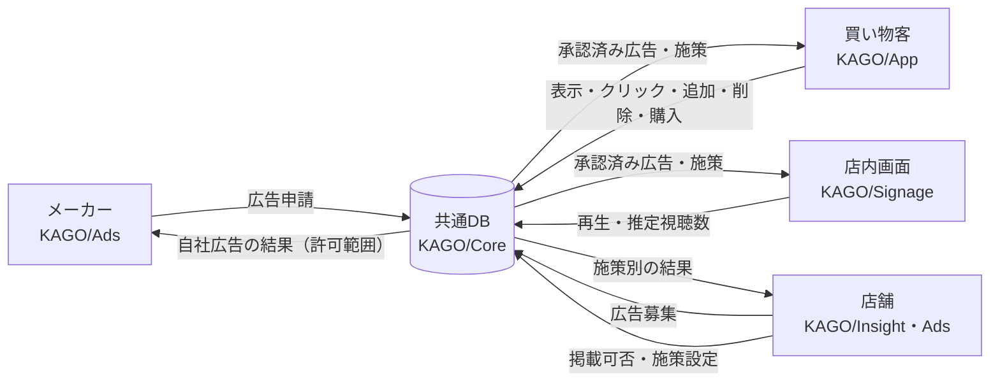

# KAGO/OS 企画書

> 買い物をもっとスムーズに、販促をデータで改善。
> お客様に必要なレコメンドを、確かに届ける。

| 項目 | 内容 |
| --- | --- |
| 作成日 | 2026-10-23 |
| 元資料 | OneDriveの`01_発表資料/20261023_KAGO.OS_企画書.pptx`（2026-10-23版） |
| 関連資料 | [共通仕様書](common-spec.md)（ID・データ形式・指標）、[Issue一覧](../issues/issues.md)（作業範囲と完成条件） |

この企画書は「何を・誰のために・なぜ作るか」をまとめたものです。データの細かい取り決めは共通仕様書、作業の分担と完成条件はIssue一覧に書きます。

## 目次

1. [背景と解決したい課題](#background)
2. [サービスのコンセプト](#concept)
3. [対象ユーザと提供価値](#users)
4. [提案（レコメンド）の種類とロジック](#recommend)
5. [システム構成](#system)
6. [デモで示す改善ループ](#loop)
7. [JPHACKSでの実装範囲](#scope)
8. [配慮すること](#considerations)
9. [検討中の事項](#open)
10. [今後の展望](#future)

## 1. 背景と解決したい課題

### 注目したこと

店舗のデジタルサイネージやPOPの多くは、広告を繰り返し表示しているだけです。店舗やメーカーには、その広告が買い物客に届き、商品選びにつながったかを確かめる手段がほとんどありません。

### 課題

- **購入結果しかわからない**：POSデータで何が売れたかはわかっても、買い物客がどの広告・提案に接して商品を選んだかとは結び付かない。
- **広告の効果を測る仕組みがない**：広告と購入結果がつながらないため、販促の費用対効果を測れず、次の施策の改善につなげにくい。

### カスタマージャーニーで見た違い

| 段階 | 広告にふれる | 商品を手に取る | お会計 |
| --- | --- | --- | --- |
| 従来、店舗に残るデータ | 残らない | 残らない | 購入結果のみ |
| KAGO/OSで残るデータ | 提案の表示（App）、広告の再生（Signage） | スキャン・かごへの追加・削除(App) | 注文・明細。同じ利用者の次回来店にも引き継ぐ(Core) |

### 解決の方向

買い物客のスマートフォンを買い物の道具にし、提案の表示から商品の追加・購入までを1回の買い物の記録としてつなぎます。店舗はその結果を見て、次の販促を改善できるようにします。

## 2. サービスのコンセプト

KAGO/OSは、買い物中の提案と、その後の行動・購入をつなぎ、店舗単位で販促を改善するためのプラットフォームです。

- 買い物客には、かごや購入履歴に合った提案で、買い物をスムーズにする。
- 店舗には、施策ごとの表示・反応・購入の結果を示し、施策の更新につなげる。
- メーカーには、店舗が募集する広告枠へ申請でき、許可された範囲で自社広告の成果を確認できる場を用意する。

## 3. 対象ユーザと提供価値

| 項目 | 買い物客 | 店舗スタッフ | 食品メーカー |
| --- | --- | --- | --- |
| 要望 | レジに並ぶ時間を減らしたい。献立を迷わず決めたい。買い忘れをなくしたい | レジ業務の負担を軽くしたい。売上を伸ばしたい。店舗DX・データ活用を進めたい | 自社ブランドの魅力を届けたい。費用対効果の高い販促をしたい |
| 現状 | セルフレジ・スキャンの利用。レシピ検索や買い物メモの活用 | セルフレジ・スキャンの導入。POSデータ・会員情報の活用。POPやデジタルサイネージによる商品訴求 | サイネージ（レシピ動画）の活用。POPや売り場企画の提案。クーポン・購入キャンペーン |
| 課題 | セルフレジ・スキャンを使える店舗が限られる。自分に合う提案を受けにくい | 専用端末・設備の導入費用がかかる。広告効果と購入結果を結び付けにくい | 広告の販促効果が測りにくい。販促の改善行動につなげにくい |
| 提供価値 | 買い物かごに基づく提案。購入履歴に基づく提案。献立の提案と買い忘れ防止 | 客のスマートフォンを活用し、専用端末を減らす。提案から商品追加・購入までを可視化。継続した購買履歴を提案と販促改善に活用 | 買い物アプリでの商品PR。提案への反応・購入結果の集計。結果の比較による販促改善 |

## 4. 提案（レコメンド）の種類とロジック

提案は目的の異なる3種類に分け、画面でも区別して表示します。広告や店舗の意図を、通常のおすすめに見せかけません。

| 区分 | 目的 | 表示される条件 | 画面の表示例 |
| --- | --- | --- | --- |
| メーカー広告 | スポンサー商品の販促 | 店舗が承認し、配信期間内で、かごの内容と関連がある | 「広告」と広告主名 |
| 店舗施策による提案 | 注力商品、時間帯の販促、フードロス対策 | 店舗が設定した対象商品・時間帯・条件を満たす | 「店舗からのおすすめ」 |
| 通常のレコメンド | 買い忘れ防止、関連商品の提案 | かご・購入履歴・一緒に買われやすい傾向から選ぶ | 「一緒におすすめ」「そろそろ補充」 |

各区分の選び方のロジックを独自に考え、KAGO/OSの独自機能とします。あわせて次の点を検討します。

- **UI**：3種類を見分けやすく、買い物の邪魔にならない見せ方。
- **優先順位**：同じ画面に3種類をどう並べるか。広告の枠数に上限を設ける。
- **マネタイズ**：メーカー広告を収益源とする仕組み。
- **効果測定**：区分ごとに表示・クリック・追加・購入を数える。
- **A/Bテスト**：提案の出し方を変えて結果を比べる。

数え方の定義は[共通仕様書の「3種類の提案」と「指標の定義」](common-spec.md#placements)にまとめています。

## 5. システム構成

5つのサービスを、共通のデータベース（KAGO/Core）でつなぎます。

| サービス | 利用者 | 主な役割 |
| --- | --- | --- |
| KAGO/App | 買い物客 | 商品スキャン・かご管理・疑似決済。かご・履歴に応じた商品提案。店舗のおすすめ・PRの表示 |
| KAGO/Ads | メーカー・店舗 | 店舗による広告の募集。メーカーによる広告の登録・申請と、レコメンド効果の確認・改善 |
| KAGO/Insight | 店舗 | 広告の掲載可否の決定。店舗の施策設定。施策別の表示・反応・購入結果の可視化と改善 |
| KAGO/Signage | 店内の画面 | 承認済み広告の配信。採用した場合はカメラで視認を推定し集計する |
| KAGO/Core | （各サービスから利用） | 店舗・商品・顧客・かご・購入・販促・広告・操作の共通データ管理と権限制御。配信・行動・購買の記録 |

## 6. デモで示す改善ループ

各サービスを並べて見せるだけでなく、店舗の施策が結果を見て更新される一周を示します。

1. 店舗がAdsで広告枠を募集する。
2. メーカーが募集を探し、広告を申請する。
3. 店舗がInsightで申請を審査し、承認する。
4. 買い物客がAppで商品をスキャンすると、かごに合った3種類の提案が表示される。店内ではSignageが承認済み広告を再生する。
5. 提案への反応（クリック・追加・削除）と購入が記録される。
6. 店舗がInsightで施策別の結果を確認し、施策を更新する。メーカーはAdsで自社広告の結果を確認する。
7. 更新した施策が、次の買い物の提案に反映される。

具体的な数値例は[共通仕様書の「架空例による机上確認」](common-spec.md#walkthrough)にあります。

## 7. JPHACKSでの実装範囲

| 区分 | 内容 |
| --- | --- |
| 事前実装（開始前に作成済み） | 紹介LP、商品スキャン、ブラウザ内のかご・商品管理、架空の購買履歴に基づくおすすめ、PWA |
| Hack Dayで目指す基本経路 | 共通DBへの接続、広告の募集・申請・承認、3種類の提案の表示、表示・操作・購買の記録、店舗向けの結果確認と施策更新、Signageでの承認済み広告の再生 |
| 購入 | Appでの疑似購入を優先する。間に合わない場合は、整合した架空の注文データで検証する |
| カメラ | Signageのカメラによる視認推定は、実機で確認してから採否を決める |
| 余力があれば | A/Bテスト、商品比較・提案を閉じる操作の記録、商品別・時間帯別の詳しい分析、店内の傾向に応じたSignageの切替 |
| 対象外 | 実際の決済・POS連携、在庫の自動取得 |

事前実装とHack Dayの成果は区別して記録します。作業の分担と完成条件は[Issue一覧](../issues/issues.md)で管理します。

## 8. 配慮すること

- **広告であることの明示**：メーカー広告には「広告」と広告主名を表示し、店舗の承認を経たものだけを配信する。
- **個人データの扱い**：メーカーや店内の画面には、個人の購買明細を渡さない。購入履歴を提案に使うかは、利用者が切り替えられる。
- **カメラ**：映像は保存・送信せず、人数と時間の推定値だけを扱う。「見た」とは断定せず推定として示す。Signageの推定と個人の購入を結び付けない。
- **効果の主張**：デモの少ない件数で売上改善を実証したとは言わない。架空データ・事前投入のデータは、その旨を明示する。

## 9. 検討中の事項

| No. | 考える必要があること | メモ |
| --- | --- | --- |
| 1 | KAGO/Appで利用者が店舗を特定する方法 | 店舗ごとのQRコードなど |
| 2 | レコメンドの効果確認・改善でのA/Bテスト | 実施する場合は、Appは利用者単位、Signageは画面・時間帯単位で比べる |
| 3 | 3種類の提案の優先順位と、広告枠の上限 | 共通仕様書の未決定事項Q-04 |
| 4 | メーカー広告のマネタイズ | 課金の単位（掲載期間・表示数・成果など）は未定 |

実装に関わる未決定事項は[共通仕様書の「未決定事項と担当」](common-spec.md#open-issues)で管理します。

## 10. 今後の展望

- 実店舗のPOS・決済、在庫・価格情報、会員・ポイント基盤との連携。
- 十分な件数での効果検証と、提案ロジックの改善。
- 複数店舗・複数メーカーでの広告募集の運用。
